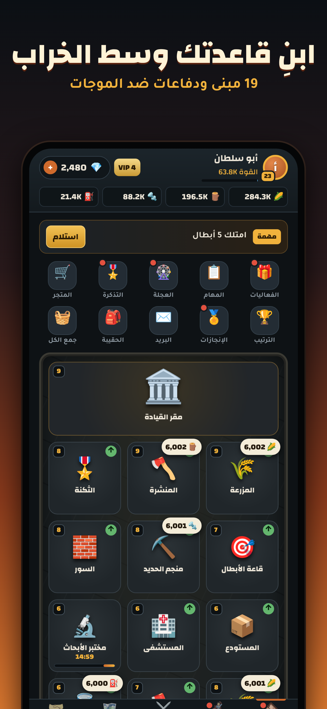
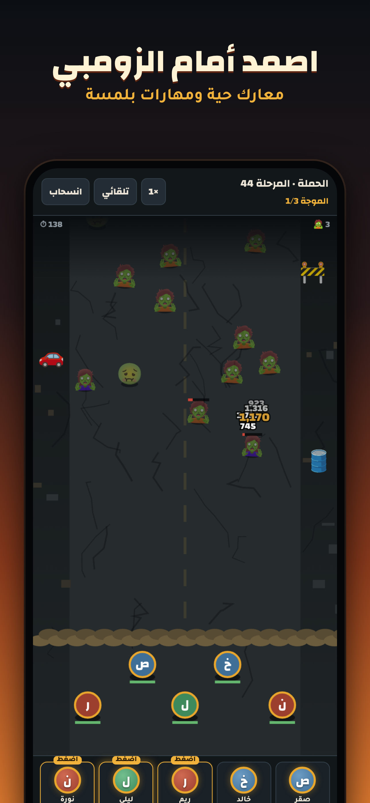
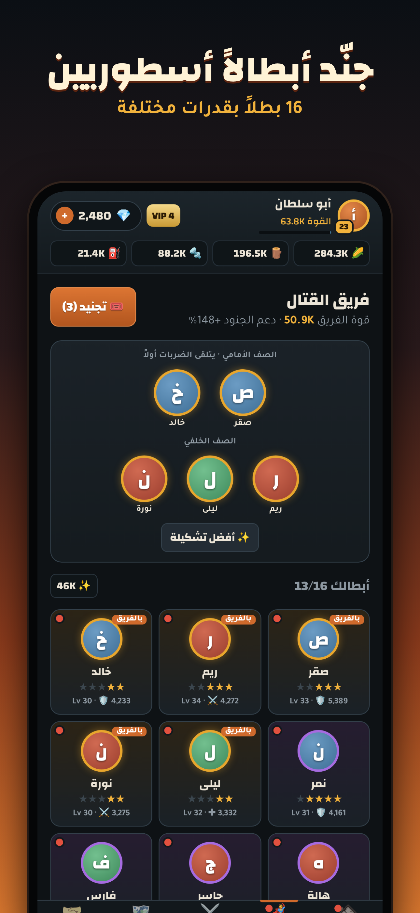
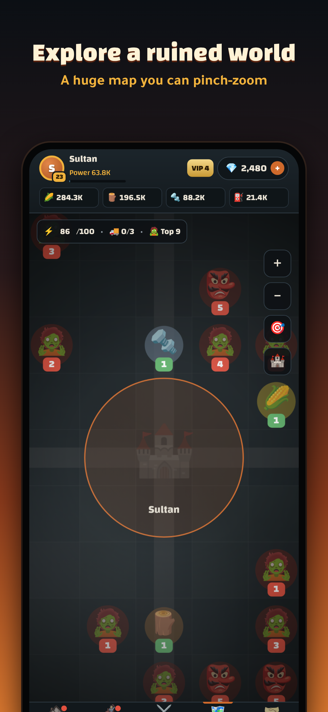
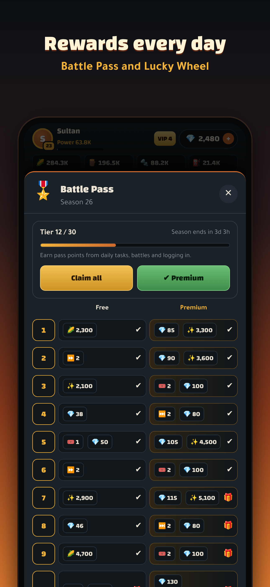

# فجر الناجين · Fajr Survivors 🧟

لعبة بقاء واستراتيجية ضد الزومبي للآيفون، بالعربي والإنجليزي. مبنية بـ HTML5 داخل تطبيق iOS حقيقي عن طريق [Capacitor](https://capacitorjs.com).

<p>
    
</p>

## وش في اللعبة

| | |
|---|---|
| 🏚️ القاعدة | 19 مبنى حتى المستوى 30، بنّاءين (3 مع VIP)، فقاعات موارد، هجمات زومبي على القاعدة |
| 🦸 الأبطال | 16 بطلاً (نادر/ملحمي/أسطوري) بـ 8 مهارات، تجنيد بضمان أسطوري، مستويات ونجوم وشظايا، تشكيلة صفين |
| ⚔️ المعارك | موجات زومبي حية، 6 أنواع منها الزعيم والعملاق، مهارات بلمسة، تسريع ×2 |
| 🗺️ العالم | خريطة 41×41 بتكبير بإصبعين وسحب بزخم وضغطتين للتكبير، 200 معسكر زومبي، حقول موارد، مسيرات |
| 🎖️ يبقيهم يلعبون | مستوى القائد، تذكرة معركة موسمية (مجاني + مميز)، عجلة حظ، إنجازات، VIP 0-10، مهام يومية وصناديق، مكافأة دخول 7 أيام، زعيم عالمي يومي، ويكند جوائز مضاعفة، إشعارات |
| 💳 الدفع | 6 حزم جواهر (ضعف أول مرة)، حزمة مبتدئين، بطاقة شهرية، تذكرة مميزة. كلها عبر Apple |
| 🛡️ تحكم الإدارة | لوحة داخل التطبيق: إحصائيات ودخل، بحث اللاعبين، إرسال جواهر وهدايا لأي لاعب أو للكل، إيقاف حسابات، فعاليات، أخبار، كمية الجواهر في الحزم، صيانة، إجبار التحديث |
| 🌐 اللغة | عربي (من اليمين لليسار) وإنجليزي (من اليسار لليمين)، يختارها اللاعب أول مرة ويغيرها من الإعدادات |

## المراحل كاملة (من جوالك، بدون ماك)

### الجزء 1: السيرفر (للتحكم الكامل) · 10 دقائق
بدون هذا الجزء اللعبة تشتغل، لكن بدون لوحة إدارة ولا ترتيب عالمي.

1. سجّل في [supabase.com](https://supabase.com) (مجاني) ← **New project**. اختر المنطقة الأقرب للاعبين (مثلاً Frankfurt أو Mumbai)، واحفظ كلمة سر قاعدة البيانات.
2. افتح **SQL Editor** ← **New query**، والصق محتوى ملف [`supabase/schema.sql`](supabase/schema.sql) كاملاً، ثم اضغط **Run**.
3. **Authentication** ← **Sign In / Providers**: فعّل **Allow anonymous sign-ins**، لأن كل لاعب ياخذ حساباً تلقائياً بدون تسجيل.
4. **Authentication** ← **Users** ← **Add user** ← **Create new user**: بريدك وكلمة سر قوية، وفعّل **Auto Confirm User**. هذا حساب المدير.
5. ارجع لـ **SQL Editor** وشغّل هذا السطر بعد ما تحط بريدك:
   ```sql
   insert into public.admins (user_id) select id from auth.users where email = 'بريدك@هنا' on conflict do nothing;
   ```
6. **Project Settings** ← **API Keys**: انسخ **Project URL** والمفتاح العام (**anon** / **publishable**). لا تنسخ المفتاح السري (service_role / secret).
7. في GitHub افتح [`src/js/config.js`](src/js/config.js) ← أيقونة القلم ✏️، وعبّي الخانتين:
   ```js
   supabaseUrl: 'https://xxxx.supabase.co',
   supabaseAnonKey: 'المفتاح العام',
   ```
   ثم **Commit changes**.

### الجزء 2: حساب أبل والمنتجات
1. اشترك في [Apple Developer Program](https://developer.apple.com/programs/enroll/) (99 دولار بالسنة).
2. [Identifiers](https://developer.apple.com/account/resources/identifiers/list) ← زر + ← App IDs ← App، وBundle ID هو `com.almghol.fajrsurvivors`.
3. [App Store Connect](https://appstoreconnect.apple.com) ← Apps ← زر + ← New App: الاسم `فجر الناجين`، اللغة Arabic، وSKU هو `FAJR001`.
4. **Business** (أو Agreements, Tax, and Banking): وقّع اتفاقية **Paid Apps** وأضف حسابك البنكي. بدونها الدفع داخل اللعبة ما يشتغل.
5. داخل التطبيق ← **Monetization** ← **In-App Purchases** ← زر +، وأنشئ هذه المنتجات. **النوع كلها Consumable**:

| Product ID | السعر المقترح | المحتوى |
|---|---|---|
| `com.almghol.fajrsurvivors.gems1` | $0.99 | 100 جوهرة |
| `com.almghol.fajrsurvivors.gems2` | $4.99 | 550 جوهرة |
| `com.almghol.fajrsurvivors.gems3` | $9.99 | 1,200 جوهرة |
| `com.almghol.fajrsurvivors.gems4` | $19.99 | 2,600 جوهرة |
| `com.almghol.fajrsurvivors.gems5` | $49.99 | 7,000 جوهرة |
| `com.almghol.fajrsurvivors.gems6` | $99.99 | 15,000 جوهرة |
| `com.almghol.fajrsurvivors.starter` | $1.99 | حزمة المبتدئين (ريم + 500 جوهرة + تذاكر) |
| `com.almghol.fajrsurvivors.monthly` | $4.99 | البطاقة الشهرية (300 + 100 يومياً × 30) |
| `com.almghol.fajrsurvivors.pass` | $9.99 | تذكرة المعركة المميزة للموسم |

   لكل منتج: اكتب الاسم والوصف بالعربي والإنجليزي، وارفع صورة مراجعة (لقطة من المتجر داخل اللعبة).

### الجزء 3: البناء والرفع (GitHub Actions على أجهزة ماك)
1. App Store Connect ← Users and Access ← Integrations ← **App Store Connect API** ← Team Keys ← زر +، وصلاحية **Admin**. حمّل ملف `.p8` (يتحمل مرة وحدة بس)، وانسخ **Key ID** و**Issuer ID**.
2. **Team ID** تلقاه في [developer.apple.com/account](https://developer.apple.com/account) تحت Membership details.
3. في GitHub ← Settings ← Secrets and variables ← Actions ← **New repository secret**:

| الاسم | القيمة |
|---|---|
| `APPLE_TEAM_ID` | رقم الفريق |
| `ASC_KEY_ID` | Key ID |
| `ASC_ISSUER_ID` | Issuer ID |
| `ASC_KEY_P8` | افتح ملف `.p8` والصق النص كامل بسطري BEGIN و END |

4. تبويب **Actions** ← **Upload to TestFlight** ← **Run workflow**. ياخذ من 10 إلى 20 دقيقة، وبعدها أبل تعالجها في 10 إلى 30 دقيقة.
5. نزّل تطبيق **TestFlight** على جوالك، وأضف نفسك في App Store Connect ← TestFlight ← Internal Testing.
6. **جرّب الشراء:** في جوالك ← الإعدادات ← App Store ← Sandbox Account، وسجّل بحساب تجريبي تنشئه من App Store Connect ← Users and Access ← Sandbox. الشراء التجريبي مجاني.

### الجزء 4: النشر
في App Store Connect ← الإصدار 1.0:
1. النصوص من [`docs/app-store.md`](docs/app-store.md) بالعربي والإنجليزي.
2. اللقطات من `docs/screenshots/ar/` (للعربي) و`docs/screenshots/en/` (للإنجليزي).
3. **سياسة الخصوصية:** انسخ [`docs/privacy.html`](docs/privacy.html) إلى [gist.github.com](https://gist.github.com) كـ Public Gist، وحط بريدك مكان `SUPPORT_EMAIL`، ثم حط الرابط.
4. **App Privacy:** اتبع الجدول في `docs/app-store.md`.
5. أضف منتجات الشراء للإصدار (In-App Purchases)، واختر النسخة من TestFlight، ثم **Submit for Review**.

## لوحة الإدارة 🛡️
داخل اللعبة: **الإعدادات** (اضغط على صورتك فوق) ← اضغط على **رقم الإصدار** في الأسفل **7 مرات** ← سجّل ببريد وكلمة سر المدير.

| التبويب | وش يسوي |
|---|---|
| لوحة | عدد اللاعبين، النشطين، الجدد، المشتريات، الدخل اليوم والكلي |
| اللاعبين | بحث بالاسم أو الرقم (#100001)، ملف اللاعب، **إرسال جواهر وأي موارد مع رسالة**، إيقاف/رفع إيقاف |
| الهدايا | هدية لكل اللاعبين بمدة انتهاء، وسجل الهدايا |
| الفعاليات | جوائز مضاعفة، إنتاج مضاعف، خصم المتجر، هدية للكل، سباق قتل، بوقت بداية ومدة، وإيقاف أو حذف |
| الأخبار | منشورات تظهر في بريد اللاعبين |
| الإعدادات | كمية الجواهر في كل حزمة، وضع الصيانة، أقل إصدار مسموح |
| المشتريات | آخر 80 عملية شراء: مين، وش اشترى، وكم دفع |

**إذا لاعب دفع ومشكلة صارت:** اطلب منه رقم اللاعب (يظهر في الإعدادات)، وابحث عنه في تبويب اللاعبين، وأرسل له الجواهر. توصله أول ما يفتح اللعبة.

> الشراء العادي يعطي الجواهر تلقائياً ويسجّل في تبويب المشتريات. ما تحتاج تضيفها يدوياً.

## للمطوّرين
```bash
npm ci
npm run build        # يبني www/index.html (التطبيق) و dist/artifact.html (نسخة ويب)
npm run check        # يتأكد إن كل نص موجود بالعربي والإنجليزي
npm test             # اختبار اللعب أوفلاين
npm run test:db      # اختبارات أمان قاعدة البيانات (Postgres داخل Node)
npm run test:online  # اختبار اللاعب والمدير ضد سيرفر تجريبي محلي
npm run screenshots  # لقطات المتجر بالعربي والإنجليزي
npx cap sync ios     # ينسخ اللعبة لمشروع iOS
```

| المسار | وش فيه |
|---|---|
| `src/js/` | كود اللعبة مقسّم: البيانات، الحالة، الصوت، السيرفر، الدفع، المنطق، الواجهة، العالم، المعارك، الإدارة |
| `src/js/01b-strings.js` | كل النصوص بالعربي والإنجليزي |
| `src/js/config.js` | إعدادات السيرفر والمنتجات |
| `supabase/schema.sql` | قاعدة البيانات وحمايتها |
| `scripts/` | البناء والاختبارات واللقطات |
| `ios/` | مشروع Xcode |

كل دفعة (push) تشغّل **iOS build check**: كل الاختبارات، ثم بناء التطبيق على ماك.

### إصدار جديد
1. عدّل الكود.
2. ارفع `appVersion` في `src/js/config.js`، و`MARKETING_VERSION` في `ios/App/App.xcodeproj/project.pbxproj` لنفس الرقم (مثلاً 1.1).
3. شغّل **Upload to TestFlight**. رقم البناء يزيد تلقائياً.
4. لو تبي تجبر الكل يحدّث: لوحة الإدارة ← الإعدادات ← أقل إصدار مسموح.
