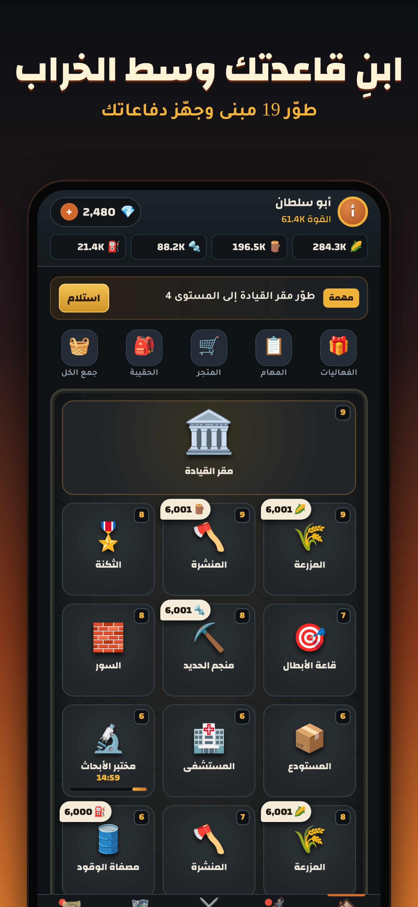

# فجر الناجين 🧟

لعبة بقاء واستراتيجية ضد الزومبي للآيفون. مبنية بـ HTML5 داخل تطبيق iOS حقيقي عن طريق [Capacitor](https://capacitorjs.com)، وتشتغل بدون إنترنت.



## محتويات المشروع

| المسار | وش فيه |
|---|---|
| `src/game.html` | كود اللعبة كامل (المصدر الوحيد، عدّل هنا) |
| `scripts/build-web.mjs` | يحوّل اللعبة لصفحة تطبيق تشتغل أوفلاين في `www/` |
| `www/fonts/` | الخطوط مدمجة داخل التطبيق (Changa و Tajawal) |
| `ios/` | مشروع Xcode للتطبيق |
| `assets/` | الأيقونة وشاشة البداية الأصلية |
| `docs/app-store.md` | نصوص صفحة المتجر جاهزة للنسخ |
| `docs/screenshots/` | لقطات المتجر بالمقاس المطلوب |
| `docs/privacy.html` | سياسة الخصوصية |
| `.github/workflows/` | بناء التطبيق ورفعه على أجهزة ماك من GitHub |

## كيف توصل اللعبة لـ App Store (من جوالك)

ما تحتاج جهاز ماك. البناء يصير على أجهزة ماك في GitHub Actions.

### 1. حساب مطوّر أبل
اشترك في [Apple Developer Program](https://developer.apple.com/programs/enroll/) بحساب Apple ID حقك. الاشتراك 99 دولار بالسنة، والموافقة تاخذ من يوم إلى يومين.

### 2. سجّل معرّف التطبيق
في [developer.apple.com](https://developer.apple.com/account/resources/identifiers/list) ← Identifiers ← زر +، اختر App IDs ثم App، واكتب:
- Description: `Fajr Survivors`
- Bundle ID (Explicit): `com.almghol.fajrsurvivors`

### 3. أنشئ التطبيق في App Store Connect
في [appstoreconnect.apple.com](https://appstoreconnect.apple.com) ← Apps ← زر + ← New App:
- Platform: iOS
- Name: `فجر الناجين` (إذا الاسم مأخوذ جرّب `فجر الناجين: زومبي`)
- Primary Language: Arabic
- Bundle ID: اختر اللي سجلته
- SKU: `FAJR001`

### 4. مفتاح API للرفع التلقائي
App Store Connect ← Users and Access ← Integrations ← App Store Connect API ← Team Keys ← زر +:
- Name: `GitHub`، Access: **Admin**
- حمّل ملف `.p8`. **يتحمّل مرة وحدة بس**، فاحفظه.
- انسخ **Key ID** و **Issuer ID** من نفس الصفحة.

ورقم الفريق **Team ID** (10 حروف) تلقاه في [developer.apple.com/account](https://developer.apple.com/account) تحت Membership details.

### 5. حط الأسرار في GitHub
في صفحة المستودع ← Settings ← Secrets and variables ← Actions ← New repository secret، وأضف أربعة أسرار:

| الاسم | القيمة |
|---|---|
| `APPLE_TEAM_ID` | رقم الفريق |
| `ASC_KEY_ID` | Key ID |
| `ASC_ISSUER_ID` | Issuer ID |
| `ASC_KEY_P8` | افتح ملف `.p8` وانسخ النص كامل بما فيه سطري BEGIN و END |

### 6. ابنِ وارفع
تبويب Actions ← **Upload to TestFlight** ← Run workflow. يخلص خلال 10 إلى 20 دقيقة، وبعدها أبل تعالج النسخة من 10 إلى 30 دقيقة.

### 7. جرّبها على جوالك
نزّل تطبيق **TestFlight** من App Store. في App Store Connect ← تطبيقك ← TestFlight، أضف نفسك كمختبر داخلي (Internal Testing)، وبتوصلك دعوة تنزّل منها اللعبة.

### 8. أرسلها للمراجعة
في App Store Connect ← تطبيقك ← الإصدار 1.0:
1. انسخ النصوص من [`docs/app-store.md`](docs/app-store.md).
2. ارفع اللقطات من `docs/screenshots/`.
3. **سياسة الخصوصية:** أبل تطلب رابطاً عاماً. أسهل طريقة: انسخ محتوى `docs/privacy.html` إلى [gist.github.com](https://gist.github.com) كـ Public Gist (وحط بريدك مكان `SUPPORT_EMAIL`)، أو اجعل هذا المستودع عاماً وفعّل GitHub Pages.
4. App Privacy: اختر Data Not Collected.
5. اختر النسخة من TestFlight، واضغط **Add for Review** ثم **Submit**.

المراجعة تاخذ عادة من يوم إلى ثلاثة أيام.

## للمطوّرين

```bash
npm ci
npm run build      # يبني www/index.html
npm test           # اختبار أوفلاين كامل بمتصفح Chromium
npx cap sync ios   # ينسخ اللعبة لمشروع iOS
npx cap open ios   # يفتح Xcode (على ماك)
npm run assets     # يعيد توليد الأيقونات من assets/
node scripts/screenshots.cjs   # يعيد توليد لقطات المتجر
```

كل دفعة (push) تشغّل **iOS build check**: اختبار اللعبة، وبناء التطبيق للمحاكي على ماك للتأكد إن المشروع سليم.

### رفع إصدار جديد
1. عدّل `src/game.html`.
2. غيّر `MARKETING_VERSION` في `ios/App/App.xcodeproj/project.pbxproj` (مثلاً 1.1).
3. شغّل Upload to TestFlight. رقم البناء يزيد تلقائياً.
