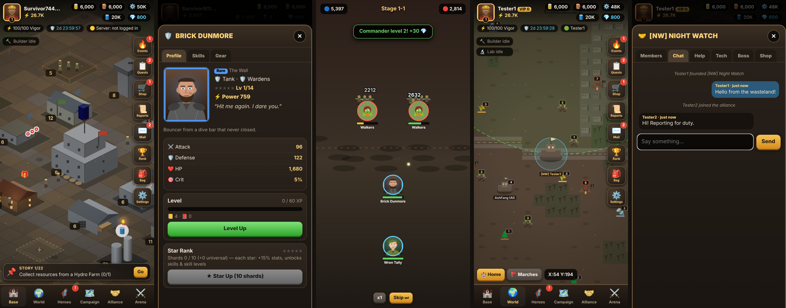

# Ashfall: Last Bastion

An original post-apocalyptic survival strategy game for **iOS and Android phones**: build a bastion, recruit
heroes, train an army, fight the horde, raid rivals and team up in alliances.
All code, art, names and characters are original — the art is drawn procedurally in code, so the
game ships with no image or audio files.



## Run it

```bash
cd game
npm start          # http://localhost:8080  (Node 18+, no npm install needed)
npm test           # 20 automated tests (game logic + server API)
```

Open the URL on your phone (same Wi-Fi: `http://<your-computer-ip>:8080`) and "Add to Home
Screen" for a full-screen app. It also runs from any static host (GitHub Pages, Netlify…) in
**offline mode** — the server is only needed for multiplayer.

## Mobile apps (iOS & Android)

The game is built phone-first: portrait 9:16, touch controls (tap, drag, pinch), safe-area aware,
tested on 320×568 up to 430×932 screens. On tablets/desktop it shows as a centered portrait column;
a sideways phone gets a "rotate" prompt. The native apps are generated with
[Capacitor](https://capacitorjs.com) and live in `android/` and `ios/`.

```bash
npm install
npm run cap:sync        # copy the game into dist/ and both native projects
npm run android         # open in Android Studio → Run / Build APK / Build Bundle (AAB)
npm run ios             # open in Xcode (macOS) → Run / Archive for App Store
ASHFALL_SERVER=https://your-server.example npm run cap:sync   # point the apps at a multiplayer server
```

What the native shell adds: portrait lock, Android back button (closes menus, double-press to exit),
haptic feedback, status bar styling, splash screen, and saves mirrored to native storage
(iOS can purge WebView storage; native Preferences survive). Progress is saved every few seconds,
after every change, and whenever the app goes to the background.

**Cloud builds:** `.github/workflows/ashfall-mobile.yml` runs the tests, builds a debug **APK** you
can download from the workflow run (Actions → "Ashfall mobile builds" → Artifacts), and compiles the
iOS app for the simulator. Set a repository variable `ASHFALL_SERVER` to bake in a server URL.

**Before store release** you still need: a signing keystore + `./gradlew bundleRelease` for Google
Play, an Apple Developer account + signing in Xcode for the App Store, a privacy policy URL, store
listings/screenshots, and an HTTPS server (iOS blocks plain HTTP). `npm run icons` regenerates the
app icon and splash screens (needs Playwright).

**Performance:** render resolution is capped at 2× (1.25× on "Battery saver"), low-end devices
start in Battery saver (30 FPS, fewer effects), the map renders at ~8 FPS while a full-screen menu
covers it, and the base terrain is pre-rendered once.

## What's in the game

| System | What works |
|---|---|
| **Base** | Isometric base, 18 building types, up to Lv 25, 5 visual tiers per building, construction timers, requirements, resource costs, builder queues, interactive menus, day/night lighting |
| **Economy** | Food, wood, metal, fuel + gems; production with tap-to-collect bubbles, offline progress, plunder protection (Depot), speedups, instant-finish with gems |
| **Research** | 28 technologies in 3 branches (Economy, Military, Defense & Field) with prerequisites and lab-level gates |
| **Troops** | 3 classes × 5 tiers with a counter triangle (Infantry › Vehicles › Ranged › Infantry); training, hospital, wounded/dead |
| **Heroes** | 30 original heroes (Rare/Epic/Legendary, tank/damage/support), unique portraits, personalities, levels, stars from shards, 3-skill trees (active/passive/command), 4 gear slots |
| **Recruitment** | Normal & elite banners, free recruit every 8 h, pity counter, duplicates → shards |
| **Gear** | Forge 12 items across 3 rarities, upgrade with parts, salvage, equip |
| **Combat** | Deterministic turn-based squad sim: front/back rows, energy-based hero skills (11 skill types), crits, counters, shields, stuns, taunts, heals; animated replays and battle reports |
| **Campaign** | 8 chapters × 10 stages with boss fights and first-clear rewards |
| **World map** | 240×240 procedural map: zombie hordes, raider camps, world bosses, resource nodes, AI rival bases, alliance territories; marches, gathering, scouting, recall, relocation, rival raids on your base |
| **Alliances** | Members, chat, help requests, tech donations, shop, gifts, alliance boss rallies |
| **PvP** | Raids on rival bases, Arena (5 attempts/day), power & arena rankings |
| **Progression** | Commander level, VIP 0-9, story quests, daily missions + activity chests, weekly missions, achievements, 7-day login calendar, rotating weekly events, mail, gem shop |
| **Audio** | Synthesized sound effects and ambient music (WebAudio) |

## Multiplayer — what's real and what isn't

Without a server (or when not logged in) the game is fully playable offline. Alliance members, arena
opponents and rival bases are **AI-simulated and labelled "AI"** in the UI.

With `npm start` and an account (⚙️ Settings → Account), the server provides:

- Accounts (scrypt-hashed passwords) and cloud saves
- Real leaderboards (power, arena points)
- Other players' bastions on the world map
- **Server-computed PvP raids and arena fights**: the server rebuilds both armies from the stored
  saves and runs the same deterministic combat engine. Results and loot are written to both saves;
  the defender is notified through an inbox.
- Online alliances: live chat (Server-Sent Events), real help requests, shared tech, shared boss HP
  with server-computed damage

**Not server-authoritative yet:** day-to-day economy (production, building, training) runs on the
client and is uploaded. The server rejects implausible jumps (gems, building levels) but a determined
cheater could still edit a save. Moving the economy tick to the server is the next step — the game
logic in `js/core` is already pure and runs unchanged in Node.

## Project layout

```
game/
  index.html, css/, manifest.webmanifest, sw.js   # client shell (PWA, offline cache)
  android/, ios/   # native app projects (Capacitor)
  capacitor.config.json, scripts/build.mjs, scripts/make-icons.cjs, icons/
  js/platform.js   # native bridge: storage, haptics, back button, status bar, quality
  js/data/     # all balance data: buildings, troops, heroes, research, items, missions, enemies
  js/core/     # pure game logic (no DOM) — shared by client, server and tests
  js/render/   # canvas renderers: base (isometric), world map, battle replay, procedural art
  js/ui/       # DOM panels: HUD, buildings, heroes, campaign, world, alliance, missions, shop…
  js/net.js    # server client
  server/      # zero-dependency Node server (HTTP + SSE, JSON file storage)
  tests/       # node:test suites
```

Tuning lives in `js/data/*`, so balance changes don't touch logic. Saves are versioned
(`SAVE_VERSION` + `migrate()` in `js/core/state.js`) for future updates.

## Server settings

| Env var | Default | |
|---|---|---|
| `PORT` | `8080` | HTTP port |
| `ASHFALL_DB` | `server/data/db.json` | JSON database file |

To use a server on another host, enter its URL in ⚙️ Settings → Account (CORS is enabled).
